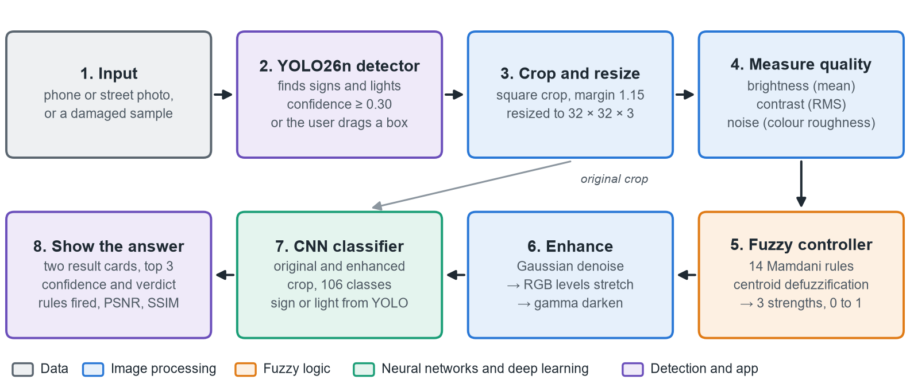

# Traffic Sign and Signal Recognition in Bad Conditions

Reads traffic signs and traffic lights from damaged images: night, haze, rain, snow, noise, blur and worn paint.
Fuzzy logic measures each image and decides how strongly to repair it, a CNN names the sign or light,
and a YOLO detector finds them in full street photos. A Streamlit app shows every step.

A mini project by Keshav Kumar, PSAIAC (Presidency School of Artificial Intelligence and Advanced Computing),
submitted to three courses: **Deep Learning**, **Image Processing and Analysis**, and **Neural Networks and Fuzzy Logic**.



## Highlights

- **0.819 macro F1** and **89.8% accuracy** on 203,374 real damaged CURE-TSR test signs (best 17-class CNN)
- **97.9% accuracy** on 281,547 traffic-light test images
- **106 sign and light classes** from 7 datasets
- Worn real signs rose from **0.597 to 0.786** macro F1 after worn-sign training
- Every score is the mean of 3 training seeds, chosen on validation data, with each test set scored once

## How it works

1. **Find:** a YOLO26n detector finds signs and lights in a photo (confidence 0.30 or more), or the user drags a box.
2. **Crop:** each box is cut out as a square and resized to 32 × 32 pixels.
3. **Measure:** brightness (mean), contrast (RMS) and noise (colour roughness).
4. **Decide:** a Mamdani fuzzy controller with 14 rules turns the three measurements into denoise, stretch and darken strengths from 0 to 1.
5. **Enhance:** Gaussian denoise, then an RGB levels stretch, then gamma darkening.
6. **Classify:** the CNN reads both the original and the enhanced crop, and the app shows both answers side by side.

## Results

Test macro F1, mean of 3 seeds:

| Model | Classes | Real signs | Simulated signs | Lights | Worn real signs |
|---|---|---|---|---|---|
| Feature MLP (HOG + colour), all conditions | 17 | 0.701 | 0.825 | 0.898 | – |
| MLP, all conditions | 17 | 0.733 | 0.878 | 0.960 | – |
| CNN, clean images + fuzzy input | 17 | 0.715 | 0.791 | 0.936 | – |
| CNN, all conditions | 17 | **0.819** | **0.909** | **0.980** | – |
| Wide CNN, all conditions | 84 | 0.757 | 0.881 | 0.946 | – |
| Global CNN, all conditions | 106 | 0.816 | 0.888 | 0.951 | 0.597 |
| Global CNN + worn signs (used by the app) | 106 | 0.808 | 0.881 | 0.959 | **0.786** |

YOLO detector 2, test mAP50: 0.701 on signs, 0.680 on lights, 0.853 on Kaggle damaged signs and 0.893 on Roboflow close-ups.

**Main finding:** training on damaged images beats repairing them (0.819 against 0.715 macro F1 on real signs),
while fuzzy enhancement still helps every model that never saw damage and leaves clean images alone.

## Datasets

| Dataset | What it adds | Images used |
|---|---|---|
| CURE-TSR | 14 signs, 12 kinds of damage at 5 levels, each with a clean original | 2,206,100 |
| LISA Traffic Light | red, yellow and green lights, day and night | 41,923 crops |
| GTSRB | real German sign photos, 43 classes | 51,839 crops |
| Indian Traffic Sign Classification (Hugging Face) | real Indian sign photos, 85 classes | 4,359 crops |
| Mapillary Traffic Sign Dataset (fully annotated part) | street signs from six continents, and an "other sign" class | 48,863 crops |
| Kaggle Damaged Signs Dataset (CC0) | faded, rusted and vandalised signs | 3,194 photos |
| Roboflow Detection_of_damage_signs (CC BY 4.0) | close-ups sorted by kind of damage | 1,996 photos |

The datasets are **not** in this repository: they take about 150 GB. To retrain, download them into `data/raw/`
and run the preparation scripts in `scripts/`, as described in [documents/workflow.md](documents/workflow.md).

## Run the app

The app needs only `models/` and `assets/`, not the datasets, and runs on a CPU.

```bash
python -m venv .venv
.venv\Scripts\activate
pip install -r requirements.txt
streamlit run app.py
```

Then open http://localhost:8501. Built and tested with Python 3.11 on Windows 11.

The app has four tabs:
- **Live demo:** a damaged sample or an uploaded photo, from measurement to the final answer.
- **Fuzzy decision:** the rules that fired.
- **Image tools:** filters, histograms and convolution.
- **Project results:** every test table.

## Automated checks

262 checks cover the image processing, fuzzy logic, models and app. Run them from the project folder:

```bash
python -m scripts.check_image_processing   # 43 checks
python -m scripts.check_fuzzy              # 36 checks
python -m scripts.check_deep_learning      # 108 checks
python -m scripts.check_app                # 75 checks
```

## Project structure

```text
app.py               Streamlit app
image_processing/    point operations, histograms, convolution, filters, quality measures, enhancement
fuzzy_logic/         membership functions, the 14 rules and the controller
deep_learning/       data loading, MLP, CNN, hand-written NumPy MLP, training and the YOLO detector
experiments/         training runs and test scoring
scripts/             dataset preparation, demos and automated checks
models/              trained CNN, MLP and YOLO weights
results/             training logs, scores and charts
assets/              sample images used by the app
documents/           report, slides, presentation speech, decision log and workflow
```

## Documents

- [Project report](documents/report/Traffic_Sign_Recognition_Report.pdf) (25 pages)
- [Presentation](documents/report/Traffic_Sign_Recognition_Presentation.pdf) (8 slides)
- [Presentation speech](documents/report/Presentation_Speech.pdf)
- [Decision log](documents/decisions.md): every design choice and why it was made

## Limitations

- A 32 × 32 input cannot read text or numbers on signs.
- Extremely faded signs still fail.

Next steps would be a larger input or a pretrained backbone, stronger sun-bleaching damage, and night and rain photo tests.

## Tech stack

Python 3.11 · PyTorch · Ultralytics YOLO26 · OpenCV · scikit-image · scikit-fuzzy · scikit-learn · pandas · matplotlib · Streamlit
